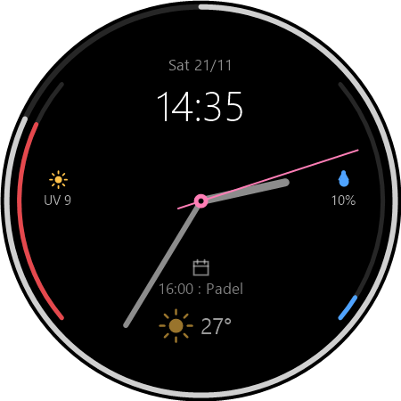

# Minimal Hybrid – Galaxy Watch watch face

A minimalist analog + digital watch face for the Galaxy Watch 9 (any watch on Wear OS 5 or newer). It's written in Watch Face Format v2 and has no code, only resources.

<p align="center">
  
</p>

## Looks

Every widget can be swapped, recoloured or hidden from the watch itself. Here are a few setups:

| Default | Sunny, high UV | Rainy, low battery |
|:---:|:---:|:---:|
|  |  |  |
| UV 3 (yellow), 40 % rain, orange accent | UV 9 turns the bar red; pink accent | 90 % rain; the battery ring turns orange when low; yellow accent |

| Fitness | Minimal | Always-on |
|:---:|:---:|:---:|
|  |  |  |
| Bars set to steps and heart rate; white hands, blue accent | Bars, date and event turned off; green accent | Seconds hidden, everything dimmed |

The screenshots are drawn mock-ups, not captures from a watch.

## What's on the face

| Widget | Default | Changeable to |
|---|---|---|
| **Left ring** | Watch battery: green arc filling from the bottom, icon + value inside | Any widget: gauges (battery, UV, rain, steps goal…), text (barometer, date, alarm, world clock…), icons and images (timer, media, recent apps) |
| **Right ring** | Daily step goal: blue arc, icon + value inside | Same as the left ring |
| **Bottom widget** (row 1) | Next calendar event: its icon above, its value below | Any widget with a text value (heart rate, sunrise, steps…), shown with its own icon |
| **Weather** (row 2) | Icon (sun, moon, cloud, rain, snow, storm, fog) + temperature, in °C or °F following the watch's settings | On / off |
| Battery ring | Charge level around the edge, orange when low | On / off |
| Date | Grey, e.g. `Wed 18/11` | On / off |
| Digital + analog time | Digital follows the phone's 12/24 h setting | Hands colour, seconds on / off |

## Customise it on the watch

The Customise screen is in English or French, following the watch's language.

1. Long-press the watch face, then tap **Customise**.
2. Swipe between the pages:
   - **Colour**: **Accent colour** (seconds hand and centre dot: orange, red, yellow, green, blue, violet, pink, white) and **Hands colour** (grey, white, dark grey).
   - **Show / hide**: set **Weather**, **Battery ring**, **Date** and **Seconds hand** to **Show** or **Hide**.
   - **Complications**: tap a widget to pick one from the watch or any installed app. The rings (**Left ring**, **Right ring**) take any widget: gauges fill the arc (green for a range, blue for a goal, the widget's own colours for segments); text, icon and image widgets show inside the ring over an empty arc. **Bottom widget** is under the clock and shows the chosen widget's icon and value.

You can do the same from the phone in the **Galaxy Wearable** app under **Watch faces → Customise**.

## Build & install

1. Open this folder in Android Studio (Ladybug or newer). Let it sync and add the Gradle wrapper.
2. On the watch, go to **Settings → Developer options** and turn on **ADB debugging** and **Debug over Wi-Fi**. Then pair from Android Studio, or run `adb connect <ip>:<port>`.
3. Build and install:
   ```bash
   ./gradlew :app:installDebug
   ```
4. Long-press the current watch face, scroll to **Minimal Hybrid** and select it.

## Files

- `app/src/main/res/raw/watchface.xml`: the whole face, including layout, colours and customisation options.
- `app/src/main/res/values/strings.xml`: names shown in the Customise screen.
- `app/src/main/res/drawable-nodpi/preview.png`: the picture shown in the watch face picker.
