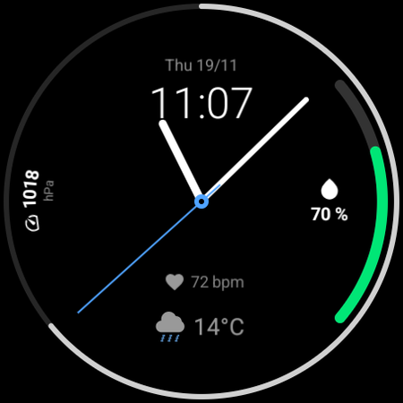
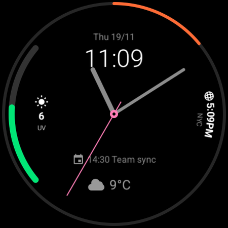
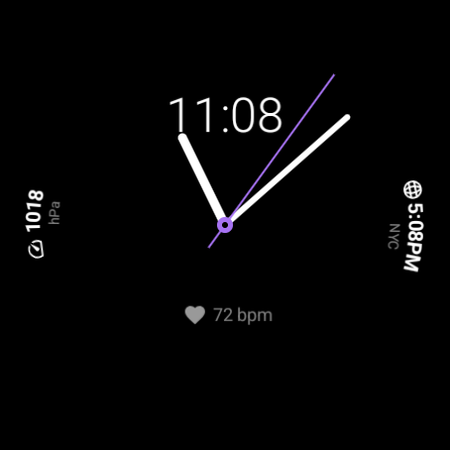
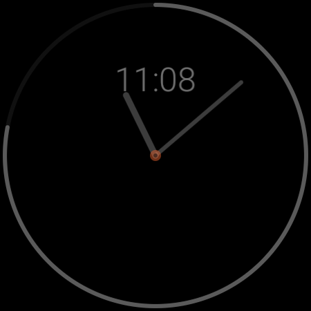

# Minimal Hybrid – Galaxy Watch watch face

A minimalist analog + digital watch face for the Galaxy Watch 9 (any watch on Wear OS 5 or newer). It's written in Watch Face Format v2 and has no code, only resources.

<p align="center">
  
</p>

## Looks

Every widget can be swapped, recoloured or hidden from the watch itself. Here are a few setups:

| Default | Rainy | Low battery |
|:---:|:---:|:---:|
|  |  |  |
| Battery and step-goal rings, next event, weather; orange accent | Barometer written along the bezel, chance of rain as a gauge, heart rate below; blue accent, white hands | The battery ring turns orange when low; UV gauge and world clock; pink accent |

| Fitness | Minimal | Always-on |
|:---:|:---:|:---:|
|  |  |  |
| Sleep stages as coloured segments, heart rate gauge, steps below; green accent | Battery ring, date and weather hidden; text widgets only; violet accent | Only the clocks and the battery ring, dimmed |

The screenshots are captured from the Wear OS emulator. The emulator has no weather or health data, so the weather and most widgets show sample values.

## What's on the face

| Widget | Default | Changeable to |
|---|---|---|
| **Left ring** | Watch battery: green arc filling from the bottom, icon, value and title centred inside | Bezel-friendly widgets only: gauges and progress bars (battery, UV, rain, steps goal…) or text written along the bezel (barometer, date, alarm, world clock…) |
| **Right ring** | Daily step goal: blue arc, icon, value and title centred inside | Same as the left ring |
| **Bottom widget** (row 1) | Next calendar event: its icon and value centred on one row | Any widget with a text value (heart rate, sunrise, steps…), shown with its own icon |
| **Weather** (row 2) | Icon (sun, moon, cloud, rain, snow, storm, fog) + temperature, in °C or °F following the watch's settings | On / off |
| Battery ring | Charge level around the edge, orange when low | On / off |
| Date | Grey, e.g. `Wed 18/11` | On / off |
| Digital + analog time | Digital follows the phone's 12/24 h setting | Hands colour, seconds on / off |

How the rings show each kind of widget:

- **Gauges** (battery, UV, rain, heart rate…): the arc fills in green, with the icon, value and title centred in the ring. If a widget sends only a number and no text (Samsung's chance of rain does this), the number is shown instead, with `%` when its range is 0–100.
- **Goals** (steps…): the arc fills in blue.
- **Segments** (sleep stages…): the arc uses the widget's own colours.
- **Text** (barometer, world clock, alarm…): no arc; the icon and value are centred along the bezel, with the title on a smaller curve inside.

**Always-on display**: only the digital clock, the hour and minute hands and the battery ring stay, dimmed to about half brightness. Widgets, weather, date and the seconds hand are hidden.

## Customise it on the watch

The Customise screen is in English or French, following the watch's language.

1. Long-press the watch face, then tap **Customise**.
2. Swipe between the pages:
   - **Colour**: **Accent colour** (seconds hand and centre dot: orange, red, yellow, green, blue, violet, pink, white) and **Hands colour** (grey, white, dark grey).
   - **Show / hide**: set **Weather**, **Battery ring**, **Date** and **Seconds hand** to **Show** or **Hide**.
   - **Complications**: tap a widget to pick one from the watch or any installed app. The rings (**Left ring**, **Right ring**) only offer bezel-friendly widgets: gauges and progress bars fill the arc (green for a range, blue for a goal, the widget's own colours for segments); text widgets are written along the bezel with their icon. **Bottom widget** is under the clock and shows the chosen widget's icon and value, centred.

You can do the same from the phone in the **Galaxy Wearable** app under **Watch faces → Customise**.

## Build & install

1. Open this folder in Android Studio (Ladybug or newer). Let it sync and add the Gradle wrapper.
2. On the watch, go to **Settings → Developer options** and turn on **ADB debugging** and **Debug over Wi-Fi**. Then pair from Android Studio, or run `adb connect <ip>:<port>`.
3. Build and install:
   ```bash
   ./gradlew :app:installDebug
   ```
4. Long-press the current watch face, scroll to **Minimal Hybrid** and select it.

## Files

- `app/src/main/res/raw/watchface.xml`: the whole face, including layout, colours and customisation options.
- `app/src/main/res/values/strings.xml`: names shown in the Customise screen.
- `app/src/main/res/drawable-nodpi/preview.png`: the picture shown in the watch face picker.
